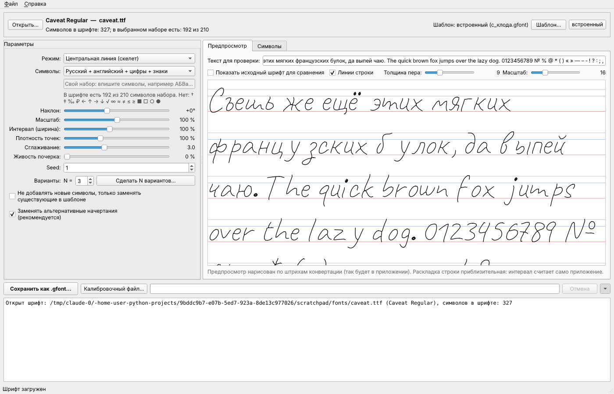
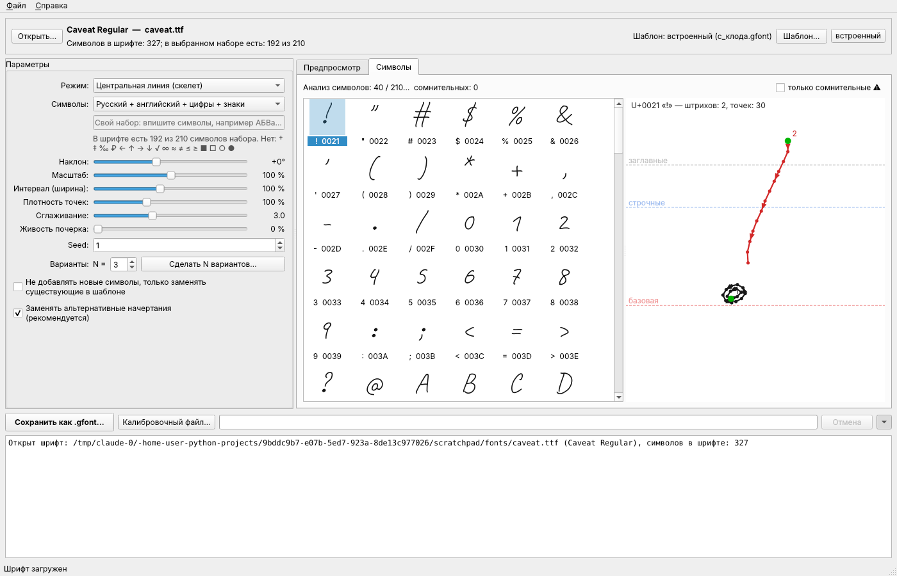
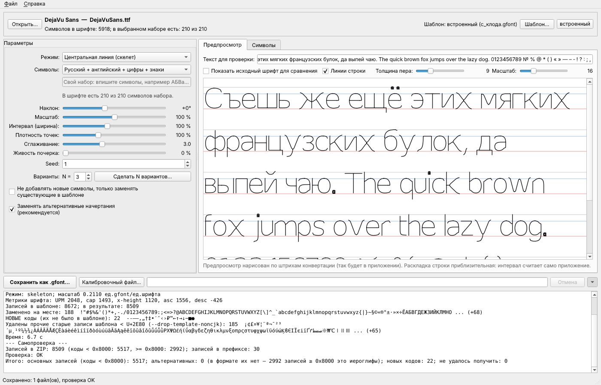

# Конвертер TTF/OTF → .gfont

Программа превращает обычный шрифт (TTF, OTF, WOFF, TTC) в файл `.gfont` для
стороннего «рукописного» приложения. В `.gfont` хранятся не контуры букв, а осевые
линии штрихов (путь ручки). Приложение рисует их пером постоянной толщины.
Поэтому конвертер находит центральные линии глифов (скелетизация) или, если нужно,
обводит контуры.

## Настольное приложение (Windows)

`GfontConverter.exe` — то же самое, что CLI, но в окне. CLI и окно вызывают один и тот
же движок (`gfont/`), поэтому результат совпадает побайтово.



- **Шрифт:** кнопка «Открыть…» или перетащите `.ttf`/`.otf` в окно. Вверху видно название
  шрифта и сколько символов выбранного набора в нём есть.
- **Шаблон** встроен в exe (`resources/с_клода.gfont`), выбирать его не нужно. Кнопка «Шаблон…»
  подключает свой, «встроенный» возвращает исходный.
- **Параметры:** режим (скелет, контур, авто), набор символов (русский + английский + цифры +
  знаки, только русские, только английские, полный, свой). Ползунки: наклон, масштаб,
  интервал (ширина), плотность точек, сглаживание, «Живость почерка» 0–100 % и seed.
  «Сделать N вариантов» сохраняет `<ИмяШрифта>_1.gfont … _N.gfont` с seed, seed+1, …
- **Предпросмотр** рисуется по штрихам, полученным конвертацией: это ровно те числа, которые
  попадут в файл. Можно наложить исходный шрифт для сравнения, менять толщину пера
  (только для просмотра) и включать линии строки. При изменении параметров предпросмотр
  обновляется через 0,3 с в фоновом потоке, окно не зависает.
- **Символы:** сетка всех символов набора. Значок ⚠ отмечает сомнительные глифы: пустые,
  слишком много штрихов, вылет за метрики. При выборе символа открывается крупный вид
  с точками, стрелками направления и номерами штрихов (зелёная точка — начало штриха).



- **Внизу:** «Сохранить как .gfont…», «Калибровочный файл…», индикатор прогресса,
  кнопка «Отмена» и сворачиваемый журнал с отчётом самопроверки. Существующие файлы
  без подтверждения не перезаписываются.



- Настройки и последние папки запоминаются в `%APPDATA%\GfontConverter\settings.json`.
  Непредвиденные ошибки пишутся в журнал и в `%APPDATA%\GfontConverter\error.log`.
- Флажок **«Заменять альтернативные начертания (рекомендуется)»** удаляет из шаблона старые
  начертания латиницы, кириллицы и символов, которые не были перерисованы
  (`--drop-template-noncjk`). Настоящих «альтернатив» в формате нет: записи ≥ 32768 —
  это иероглифы, и программа их не трогает (см. раздел про формат).

Запуск из исходников: `run_gui.bat` (при первом запуске создаёт `.venv` и ставит
зависимости) или `python gfont_gui.py [шрифт.ttf]`.

Самопроверки, которые работают и в exe (у exe нет консоли, поэтому результат пишется в файл):

```
GfontConverter.exe --selftest  C:\Windows\Fonts\arial.ttf папка   -> папка\selftest.txt
GfontConverter.exe --smoke-gui C:\Windows\Fonts\arial.ttf папка   -> папка\smoke.txt + скриншоты
GfontConverter.exe --cli шрифт.ttf out.gfont --template ...       (CLI внутри exe)
```

## Как собрать exe на Windows

1. Установите Python 3.11+ с python.org (отметьте «Add python.exe to PATH»).
2. Дважды щёлкните `build_exe.bat` или запустите его в cmd из папки `gfont_converter`.
   Скрипт сам:
   - создаёт `.venv` и ставит `requirements.txt` + `requirements-gui.txt` (PySide6, PyInstaller);
   - прогоняет тесты (пропустить: `build_exe.bat notest`);
   - собирает `dist\GfontConverter.exe` по `GfontConverter.spec` (один файл, без консоли,
     со значком `resources\icon.ico`, со встроенным шаблоном);
   - запускает собранный exe в режиме `--selftest` и печатает результат.
3. Готовый `dist\GfontConverter.exe` можно копировать на любой компьютер с Windows 10/11:
   Python там не нужен.

Та же сборка автоматически выполняется в GitHub Actions
(`.github/workflows/gfont-windows.yml`) на каждый push. Там exe дополнительно
запускается без Python в PATH и в чистом контейнере Windows Server Core, где Python нет вообще.
Готовый exe можно скачать на странице запуска workflow (артефакт `GfontConverter-exe`).

### Что проверено автоматически (GitHub Actions, windows-2022)

| Проверка | Результат |
|---|---|
| `build_exe.bat ci`: venv, зависимости, все тесты на Windows, PyInstaller | OK |
| Размер `GfontConverter.exe` | 99 170 387 байт ≈ 95 МБ (почти всё — Qt, numpy, scipy) |
| exe скопирован в папку `Чистый запуск с пробелом`, PATH = только `C:\Windows`: `--selftest` и `--smoke-gui` (сохранение в `смоук тест\Arial_1.gfont`) | OK |
| Обычный запуск окна (платформа Qt `windows`), 25 с работы, снимок экрана | OK |
| Контейнер Windows Server Core **без Python** (`python отсутствует`): `--selftest` и `--smoke-gui` | OK |

Не проверено: живой человек в окне на Windows 10/11 с HiDPI-экраном (масштаб 125–200 %)
и работа рядом с антивирусом. Exe не подписан цифровой подписью, поэтому Windows
SmartScreen может предупредить при первом запуске («Подробнее» → «Выполнить в любом случае»).

## CLI: установка из исходников (Windows)

1. Установите Python 3.10+ с python.org (при установке отметьте «Add python.exe to PATH»).
2. В cmd или PowerShell, в папке проекта:

```
python -m venv .venv
.venv\Scripts\activate
pip install -r requirements.txt
```

3. Положите шаблоны `.gfont` в папку `templates\` (или укажите к ним полный путь).

## Команды

Конвертация (основной сценарий):

```
python convert.py шрифт.ttf результат.gfont --template templates\с_клода.gfont --drop-template-noncjk --preview превью.png
```

Калибровочный файл (шрифт не нужен) — его нужно загрузить в приложение первым:

```
python convert.py --calibrate калибровка.gfont --template templates\с_клода.gfont --preview калибровка.png
```

Проверить любой `.gfont` и нарисовать его:

```
python convert.py --validate результат.gfont
python convert.py --inspect результат.gfont --sheet лист.png --preview строки.png
```

Ещё примеры:

```
:: только русский алфавит и цифры, без новых кодов (только замена на месте)
python convert.py font.ttf out.gfont --template templates\с_клода.gfont --charset russian,digits,ascii --no-new-entries

:: «контурный» или однолинейный шрифт
python convert.py font.ttf out.gfont --template templates\с_клода.gfont --mode outline

:: три варианта «живого» почерка
python convert.py font.ttf v1.gfont --template templates\с_клода.gfont --variation 1 --seed 1
python convert.py font.ttf v2.gfont --template templates\с_клода.gfont --variation 1 --seed 2
python convert.py font.ttf v3.gfont --template templates\с_клода.gfont --variation 1 --seed 3

:: подгонка: наклон 10°, чуть крупнее, своя строка в превью
python convert.py font.ttf out.gfont --template templates\с_клода.gfont --slant 10 --scale 1.1 --preview p.png --preview-text "Съешь ещё этих булок"
```

`python convert.py --help` выводит все опции.

### Основные опции

| Опция | Что делает |
|---|---|
| `--template` | шаблон `.gfont`: из него берутся префикс, непрозрачный блок и все записи, которые не трогаются |
| `--mode skeleton` | (по умолчанию) центральная линия заливки глифа |
| `--mode outline` | контуры как штрихи; контур «туда-обратно» однолинейного шрифта превращается в открытый штрих |
| `--mode auto` | `outline`, если контуры шрифта вырожденные (однолинейный шрифт), иначе `skeleton` |
| `--charset` | `default` (ASCII, Latin-1, кириллица U+0400–04FF, пунктуация и знаки), `ascii`, `latin1`, `cyrillic`, `russian`, `digits`, `punct`, `U+0400-U+04FF`, `chars:абв№`, `@файл.txt`; через запятую, `-элемент` исключает. Пробелы, мягкий перенос U+00AD, управляющие и комбинируемые знаки отбрасываются; коды > U+FFFF тоже |
| `--no-new-entries` | не добавлять коды, которых нет в шаблоне |
| `--preserve-template-extra` | не удалять записи шаблона для символов из charset, которых нет в шрифте (по умолчанию удаляются, чтобы не вылезал старый стиль) |
| `--drop-template-noncjk` | удалить все остальные нетронутые записи шаблона с кодами < U+2E80 (латиница, греческий, кириллица, символы старого стиля). **Для `с_клода.gfont` рекомендуется**: там эти записи битые (см. ниже) |
| `--baseline`, `--cap-height`, `--x-height`, `--size-by` | целевые метрики (по умолчанию −85 и 315, по эталону blood8) |
| `--scale`, `--slant`, `--spacing` | ручная подгонка: размер, наклон в градусах, ширина по X |
| `--variation N --seed S` | «живость»: случайный наклон/масштаб/поворот/дрожание каждого глифа (N≈0.5–1.5) |
| `--step`, `--smooth`, `--corner` | шаг точек (эталон ≈ 27), сглаживание, какой излом сохранять углом |
| `--dot-radius`, `--fill-spacing` | размер спирали для точек и шаг колец заливки крупных пятен (● ■ •) |
| `--raster`, `--spur`, `--end-extend`, `--snap` | параметры скелетизации |
| `--preview`, `--sheet` | PNG, отрисованные **из записанного .gfont** (не из TTF) |
| `--report` | отчёт в JSON |
| `--jobs` | число процессов (по умолчанию по числу ядер) |

## Как работает конвейер (`--mode skeleton`)

1. **Контуры.** fontTools достаёт контуры глифа, кривые Безье разбиваются на плотные ломаные.
2. **Растр.** Контуры заливаются по правилу nonzero (поэтому корректно обрабатываются перекрывающиеся
   контуры рукописных шрифтов), 1000 px на em. Мелкий мусор убирается, микродырки заливаются.
3. **Точки.** Сплошные компактные компоненты (точка над i/ё, «.», «:», точки «!?;») становятся
   спиралью из 6 точек. Крупные пятна (● ■ •) заливаются концентрическими кольцами по форме пятна.
4. **Скелет.** `skimage.morphology.skeletonize`, затем граф: узлы (концы и развилки) и рёбра.
   Ложные узлы от «лесенок» склеиваются, короткие шипы удаляются, близкие развилки пересечения
   (x, Ж, *) стягиваются в одну, концы продлеваются до края штриха. Петли (о, б, в, ф, 8, @)
   остаются замкнутыми.
5. **Штрихи.** Граф обходится так, чтобы покрыть все рёбра с минимумом подъёмов пера.
   В развилке выбирается самое прямое продолжение, потом штрихи, сходящиеся в одном узле,
   склеиваются. Штрихи ориентируются сверху вниз и слева направо.
6. **Нормализация.** Масштаб считается по высоте заглавной (`OS/2.sCapHeight` или по H) либо
   по x-height. Y инвертируется, буквы с хвостами (Д Ц Щ д щ р у ф ц) уходят ниже базовой линии
   и не сжимаются. X центрируется по bbox.
7. **Упрощение.** Углы находятся через RDP, куски между углами сглаживаются по Гауссу
   и передискретизируются с шагом около 25.
8. **Сборка и самопроверка.** Подробнее ниже.

## Формат .gfont (проверено на двух эталонах)

Всё, кроме ZIP, хранится в big-endian.

```
u32 version = 5
u32 L                       длина непрозрачного блока (80 в с_клода, 88 в blood8)
L байт                      непрозрачный блок; копируется как есть
u32 K                       число записей в префиксе (30 в с_клода, 10 в blood8)
K записей глифов            побайтовые копии zip-записей с теми же кодами
ZIP (deflate)               дописан сразу после префикса
```

Запись глифа (она же содержимое zip-записи):

```
u16 code; u32 nf (= 2*npts); nf × float32 (x, y); u32 npts; npts × u8 флагов (0 — начало штриха, 1 — продолжение)
длина = 10 + 4·nf + npts
```

Что подтвердилось на файлах:
- Префикс разбирается без остатка: сразу за K записями начинается `PK\x03\x04`.
- Все K префиксных записей побайтово совпадают с zip-записями.
- Во всех 12 285 записях обоих эталонов длина совпадает с формулой, код в заголовке
  совпадает с именем, флаги только 0/1, первый флаг 0. Штрихов из одной точки нет (минимум 2 точки).
- flag_bits = 0 (с_клода) или 2048 (blood8), deflate, комментария нет, extra-полей нет.
- **Уточнение:** смещения внутри ZIP отсчитываются от начала ZIP, а не от начала файла. ZIP —
  это самостоятельный архив, просто дописанный после префикса. `zipfile` открывает весь файл, потому
  что сам учитывает такой сдвиг.
- Система координат blood8: базовая линия −80…−96, верх строчных ≈ −306 (x-height ≈ 220),
  заглавные ≈ −399 (≈ 315), верхние выносные ≈ −448 (≈ 365), нижние ≈ +65 (≈ 150).
  Ширины: H 211, o 123, i 76, m 270, W 314. ~21 точка на глиф, шаг ≈ 27, X-центр bbox ≈ 0.
  CJK-иероглифы занимают квадрат ≈ 405 × 455 (от −457 до −4 по Y).

Round-trip: чтение → запись даёт **побайтово тот же файл** для обоих эталонов.
Нетронутые записи копируются вместе с исходным сжатым потоком.

### ⚠ Расхождения с исходным описанием

1. **Записи с кодами ≥ 32768 не «альтернативы» (код + 32768).** Это обычные символы
   Unicode U+8000–U+FFFF: CJK-иероглифы (2687 в с_клода, 1032 в blood8), Private Use Area
   (261 в с_клода) и полноширинные формы (U+FF00–FFEF). Например, запись 32842 (0x804A)
   — это иероглиф 聊, а не вариант «J». Ни одна такая запись не совпадает геометрически
   со своей «парой» код−32768, а у 90+ % таких записей пары нет вообще. Поэтому конвертер
   их **не трогает** (иначе испортились бы иероглифы шаблона). Своих вариантов начертания
   в формате, судя по эталонам, нет. `--variation` даёт разные начертания в разных файлах
   (разные `--seed`), а внутри одного файла у символа ровно один глиф.
2. **В `с_клода.gfont` почти вся «западная» часть битая.** У ~200 записей латиницы, кириллицы,
   греческого, Latin-1 и символов координаты X доходят до ±9750 (например, «o» шириной 6800),
   а сами формы похожи на зигзаги. CJK там нормальные. Если с_клода — шаблон, используйте
   `--drop-template-noncjk`: тогда всё, что конвертер не перезаписал, удалится, и мусор не вылезет.
   Метрики я брал только из blood8.
3. В `blood8真迹4` нет кириллицы, а в `с_клода` её коды есть. Поэтому с шаблоном с_клода
   кириллица заменяется на месте, а с blood8 станет новыми записями.

## Неизвестные свойства формата (честно)

| Что | Как сейчас | Как проверить |
|---|---|---|
| Назначение непрозрачного блока L (80/88 байт, высокая энтропия; в другом файле 104) | копируется из шаблона без изменений | — |
| Принимает ли приложение новые коды (которых не было в шаблоне) | добавляются в конец ZIP и перечисляются в отчёте как «НОВЫЕ коды»; `--no-new-entries` запрещает их | калибровочный файл: перечёркнутые прямоугольники на новых кодах |
| Как приложение считает межбуквенный интервал | неизвестно; глифы центрируются по bbox, как в эталоне | калибровка: цифры 0–9 — прямоугольники ширины 20…380; `a`/`b`; `d`/`e` |
| Влияют ли одиночные move-to (1 точка) на интервал и видны ли они | по умолчанию не используются; `--side-anchors` ставит их на края ширины символа из TTF | калибровка: `a` (якоря) против `b` (без) |
| Толщина пера | определяется приложением | калибровка: `f` — вертикали с зазорами 5…50 |
| Положение на строке (смещение вверх/вниз) | базовая линия −85, заглавная 315 | калибровка: `= # _ I | y`; при смещении поправьте `--baseline` |
| Что значат K записей префикса | копируются из шаблона; если их код перезаписывается, префикс обновляется синхронно | — |

`--spacing` пока просто растягивает или сжимает глиф по X. Это грубая подгонка до тех пор,
пока калибровка не покажет, как приложение на самом деле считает интервал.

## Самопроверка (выполняется после каждой записи)

- файл открывается `zipfile`, `testzip()` без ошибок;
- каждая запись: длина = 10 + 4·nf + npts, nf = 2·npts, флаги 0/1, код в заголовке = имени;
- нет NaN/inf, |x|, |y| < 2000 (для записей шаблона — только предупреждение);
- K префиксных записей совпадают с zip-записями;
- нет пустых глифов у букв, цифр и пунктуации, которые были сконвертированы.

В отчёте указано: сколько записей заменено на месте, сколько добавлено новых, какие символы
подставлены (например, ‑ U+2011 → дефис), каких нет в шрифте, что удалено из шаблона.

## Структура проекта

```
convert.py            CLI
gfont_gui.py          точка входа GUI и exe (--selftest, --smoke-gui, --cli)
gui/main_window.py    главное окно
gui/preview_widget.py предпросмотр строки по штрихам
gui/glyph_view.py     сетка символов и крупный вид символа
gui/workers.py        фоновые потоки (предпросмотр, анализ, сохранение с отменой)
gui/settings.py       настройки в %APPDATA%\GfontConverter\settings.json
gui/app.py, selftest.py  запуск, перехватчик ошибок, самопроверки
gfont/session.py      фасад движка для GUI (кэш форм, параметры, диагностика)
gfont/errors.py       понятные сообщения об ошибках
resources/            значок, встроенный шаблон с_клода.gfont
build_exe.bat, GfontConverter.spec, run_gui.bat
gfont/format.py       чтение и запись префикса, записей и ZIP (собственный writer)
gfont/extract.py      TTF → растр → скелет → граф → штрихи; режим outline
gfont/normalize.py    метрики, масштаб, наклон, «живость», сглаживание, передискретизация, спирали
gfont/charset.py      наборы символов, подстановки
gfont/build.py        сборка файла и отчёт
gfont/calibrate.py    калибровочный файл
gfont/preview.py      превью из записанного .gfont
gfont/validate.py     самопроверка
tests/                pytest: round-trip эталонов, encode/parse, валидатор, конвейер
examples/             превью для DejaVu Sans, Caveat, Marck Script и калибровки
```

Тесты: `python -m pytest tests`. Round-trip эталонов выполняется для всех `*.gfont`
из `templates\` (или из папки в переменной `GFONT_TEMPLATES`). Если файлов нет, эти тесты пропускаются.
