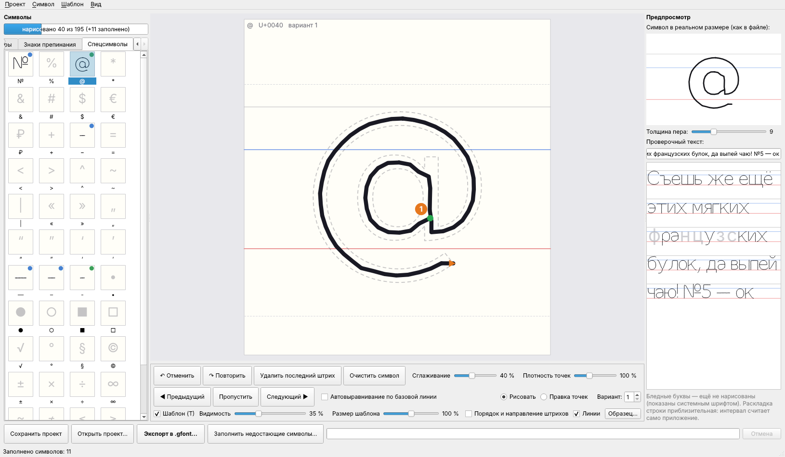
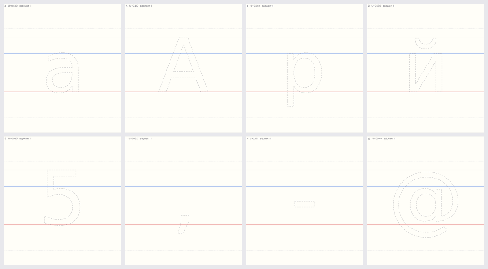
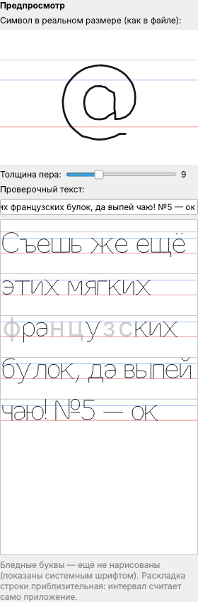

# Конвертер TTF/OTF → .gfont

Программа превращает обычный шрифт (TTF, OTF, WOFF, TTC) в файл `.gfont` для
стороннего «рукописного» приложения. В `.gfont` хранятся не контуры букв, а осевые
линии штрихов (путь ручки). Приложение рисует их пером постоянной толщины.
Поэтому конвертер находит центральные линии глифов (скелетизация) или, если нужно,
обводит контуры.

## Настольное приложение (Windows)

`GfontConverter.exe` — то же самое, что CLI, но в окне. CLI и окно вызывают один и тот
же движок (`gfont/`), поэтому результат совпадает побайтово.


- **Шрифт:** кнопка «Открыть…» или перетащите `.ttf`/`.otf` в окно. Вверху видно название
  шрифта и сколько символов выбранного набора в нём есть.
- **Шаблон** встроен в exe (`resources/с_клода_дополненный.gfont`: исходные иероглифы и знаки
  с_клода плюс латиница, кириллица и греческий почерком Caveat под те же мерки), выбирать его не нужно. Кнопка «Шаблон…»
  подключает свой, «встроенный» возвращает исходный.
- **Параметры:** режим (скелет, контур, авто), набор символов (русский + английский + цифры +
  знаки, только русские, только английские, полный, свой). Ползунки: наклон, масштаб,
  интервал (ширина), плотность точек, сглаживание, «Хвосты строчных», «Живость почерка» 0–100 % и seed.
  **«Хвосты строчных»** поджимают флажки и хвосты, торчащие вбок за основу буквы (флажок «б»,
  хвосты «у», «з», «j»). Приложение ставит буквы по крайним точкам, поэтому длинный флажок
  давал большой пробел после «б». По умолчанию 35 %, 100 % — как в шрифте (CLI: `--overhang`).
  Флажок **«Порядок штрихов как при письме рукой»** (включён по умолчанию, CLI: `--no-hand-order`
  отключает) задаёт, в каком порядке и в какую сторону «пишется» каждая буква:
  вертикальные штрихи — сверху вниз, пологие — слева направо; петли («о», «0», «б», «в», «д») —
  против часовой стрелки, начиная сверху чуть правее середины; сначала основные штрихи слева
  направо (в одной колонке — сверху вниз: «З», «Е»), потом перекладины («Н», «А», «t»),
  у букв последними — точки и надстрочные знаки («i», «ё», «й», «á»).
  «Сделать N вариантов» сохраняет `<ИмяШрифта>_1.gfont … _N.gfont` с seed, seed+1, …
- **Предпросмотр** рисуется по штрихам, полученным конвертацией: это ровно те числа, которые
  попадут в файл. Можно наложить исходный шрифт для сравнения, менять толщину пера
  (только для просмотра) и включать линии строки. При изменении параметров предпросмотр
  обновляется через 0,3 с в фоновом потоке, окно не зависает.
- **Символы:** сетка всех символов набора. Значок ⚠ отмечает сомнительные глифы: пустые,
  слишком много штрихов, вылет за метрики. При выборе символа открывается крупный вид
  с точками, стрелками направления и номерами штрихов (зелёная точка — начало штриха).


- **Внизу:** «Сохранить как .gfont…», «Калибровочный файл…», индикатор прогресса,
  кнопка «Отмена» и сворачиваемый журнал с отчётом самопроверки. Существующие файлы
  без подтверждения не перезаписываются.


- Настройки и последние папки запоминаются в `%APPDATA%\GfontConverter\settings.json`.
  Непредвиденные ошибки пишутся в журнал и в `%APPDATA%\GfontConverter\error.log`.
- Флажок **«Удалять буквы шаблона, которых нет в шрифте»** (по умолчанию выключен). Если он
  выключен и в вашем шрифте нет какой-то буквы (например, «ё» или «ā»), остаётся буква из
  встроенного шаблона, выровненная по тем же меркам. Если включён, такие буквы удаляются и
  в файле остаётся только почерк вашего шрифта (`--drop-template-noncjk`). Знаки шаблона
  (№ √ Ⅰ ① …), иероглифы и служебные записи не трогаются никогда. Настоящих «альтернативных
  начертаний» в формате нет: записи ≥ 32768 — это иероглифы.
- Значок exe — чёрно-белая голова льва (`tools/make_icon.py` рисует `resources/icon.ico`).

Запуск из исходников: `run_gui.bat` (при первом запуске создаёт `.venv` и ставит
зависимости) или `python gfont_gui.py [шрифт.ttf]`.

Самопроверки, которые работают и в exe (у exe нет консоли, поэтому результат пишется в файл):

```
GfontConverter.exe --selftest  C:\Windows\Fonts\arial.ttf папка   -> папка\selftest.txt
GfontConverter.exe --smoke-gui C:\Windows\Fonts\arial.ttf папка   -> папка\smoke.txt + скриншоты
GfontConverter.exe --cli шрифт.ttf out.gfont --template ...       (CLI внутри exe)
GfontConverter.exe --smoke-draw папка                              -> папка\smoke_draw.txt
```

## Режим «Нарисовать свой почерк»

Второй режим приложения — не конвертация шрифта, а редактор глифов: каждый символ рисуется
мышкой, пером или на тачпаде по шаблону, а в конце получается `.gfont` с вашим почерком.
Открывается кнопкой **«✍ Нарисовать свой почерк…»** в главном окне (или Файл → Нарисовать
свой почерк, Ctrl+D, или `GfontConverter.exe --draw`). Код — отдельный модуль
`gui/draw_mode/`. Формат, сборка по шаблону, самопроверка и предпросмотр берутся из того же
движка, что и в конвертере, своей логики формата в режиме нет.



- **Слева** — символы по вкладкам: строчные и заглавные русские, строчные и заглавные
  английские, цифры, знаки препинания, спецсимволы (№ % @ * « » — – ‑ • ● ○ ■ √ …). У каждого
  символа есть миниатюра и статус: зелёная точка — нарисован, синяя — заполнен автоматически,
  серая с чертой — пропущен. Сверху шкала «нарисовано N из M».
- **В центре** — холст, по умолчанию вписанный в окно. На нём линии тетради: базовая
  (красная), строчных (синяя), заглавных (серая), выносных (пунктир); их можно отключить.
  Рисование: нажали левую кнопку — пошёл штрих, отпустили — штрих готов, следующее нажатие
  начинает новый (так рисуются «й», «ё», «!», «=», «%»). Клик без движения — точка. У каждого
  штриха видны номер, начало (зелёная точка) и стрелка направления. Колесо мыши меняет
  масштаб, пробел + перетаскивание (или средняя кнопка) двигает холст. Давление пера
  не используется: в формате толщина постоянная.
- **Шаблон-подсказка** — серый пунктирный контур буквы из шрифта-образца (по умолчанию
  встроенный DejaVu Sans; можно выбрать свой TTF/OTF или `.gfont`, тогда пунктиром показаны
  его штрихи). Строчные масштабируются по x-height шрифта, остальное — по высоте заглавных,
  поэтому «о» ниже «О», «р» и «у» уходят под линию, запятая стоит у базовой линии, дефис —
  посередине строчных. Шаблон стоит по центру клетки, его базовая линия совпадает с линией
  холста. Если символа нет в образце, рисуется пунктирная рамка нужной высоты с самим символом.
  Переключатель «Шаблон (T)», ползунок видимости (35 %), «Размер шаблона» ±20 % (меняет
  разметку холста вместе с шаблоном, размер букв в файле от него не зависит) и «Порядок и
  направление штрихов» (осевая линия образца с номерами и стрелками). Шаблон — отдельный
  слой: в штрихи, предпросмотр и экспорт он не попадает (это проверяет тест).



- **Под холстом:** «Отменить» (Ctrl+Z), «Повторить» (Ctrl+Y), «Удалить последний штрих»
  (Backspace), «Очистить символ», «Сглаживание» 0–100 %, «Плотность точек»,
  «Автовыравнивание по базовой линии», «◀ Предыдущий» (←), «Пропустить», «Следующий ▶»
  (Enter или →), «Правка точек» (перетаскивание точек, правая кнопка мыши удаляет штрих),
  «Вариант» 1–5 (несколько попыток одного символа).
- **Справа** — символ в реальном размере (по тем же штрихам, что попадут в файл), толщина пера
  и строка-тест: вводите текст и сразу видите его своим почерком. Ненарисованные буквы
  показаны бледным системным шрифтом.



- **Внизу:** «Сохранить проект» (Ctrl+S), «Открыть проект…», «Экспорт в .gfont…»
  (Ctrl+E, в фоне, с прогрессом и отменой), «Заполнить недостающие символы…».
- **Обработка штриха** (при отпускании кнопки): убрать повторы и дрожание, сгладить (сначала
  дрожание руки, потом гаусс между углами — тот же код, что в конвертере; при 0 % острые углы
  остаются как есть), равномерный шаг точек 25 / плотность (первая и последняя точка
  сохраняются), точку превратить в спираль из 6 точек. В проекте хранится сырой штрих в
  координатах холста, а в координаты `.gfont` он переводится при показе и экспорте, поэтому
  сглаживание, плотность и размер разметки можно менять без перерисовки.
- **Метрики:** одна клетка на все символы; положение относительно базовой линии — как
  нарисовано (поэтому «р», «у», «д» уходят вниз). «Автовыравнивание» подтягивает низ буквы
  к базовой линии, если он не дальше 12 % высоты заглавных, и не трогает буквы с нижними
  выносными. Если строчные нарисованы почти такой же высоты, как заглавные (или намного ниже),
  внизу окна появляется предупреждение. При экспорте можно выбрать «Нормализовать размеры»
  (строчные к одной x-height, заглавные к одной высоте по медиане нарисованного, не больше
  ±25 %) или «Сохранить как есть». X центрируется по bbox глифа, Y направлен вниз.
- **Недостающие символы:** (А) из шрифта TTF/OTF через конвертер, с подгонкой размера под
  ваш почерк; (Б) из похожих: ‑ − – — из дефиса, ё/Ё = е/Е + две точки, й/Й = и/И + дужка,
  № = N + маленькая o с чертой, одинаковые буквы кириллицы и латиницы (а↔a, Р↔P …);
  (В) оставить пустыми. Перед применением всё показывается миниатюрами с галочками.
  «Шаблон → Использовать образцы шрифта как заготовку» кладёт буквы шрифта на холст
  как стартовую форму, которую можно править.
- **Проект `.gfproj`** — JSON (UTF-8): версия, размеры клетки, настройки, по каждому символу
  штрихи в координатах холста, варианты, статус и источник. Автосохранение каждые 30 с в
  `%APPDATA%\GfontConverter\drafts\`; если программа закрылась без сохранения, при следующем
  открытии режима она предложит восстановить черновик. «Проект → Открыть существующий .gfont
  в редакторе» загружает штрихи готового файла (их можно править), и экспорт собирается
  поверх этого же файла.
- **Экспорт** собирается тем же кодом, что и в конвертере (`gfont.build.write_glyphs` и
  `save_and_validate`): шаблон (по умолчанию встроенный), замена или добавление записей,
  атомарная запись, самопроверка. Отчёт показывает, сколько символов нарисовано вами, сколько
  заполнено автоматически и каких нет. Если что-то не нарисовано, программа предупредит и
  предложит заполнить. По умолчанию буквы шаблона старого стиля (< U+2000), которых нет в
  проекте, удаляются; иероглифы не трогаются.
- **Варианты и коды ≥ 32768.** Несколько попыток одного символа хранятся в проекте. Записать
  их в «код + 32768» можно флажком при экспорте: туда пойдёт вариант 2, а если его нет — слегка
  изменённая копия по seed. **По умолчанию флажок выключен.** В обоих эталонах эти коды —
  обычные иероглифы (0x8430 = «а» + 32768 = «萰»), а не альтернативы (см. «Расхождения с
  исходным описанием» ниже). Включайте флажок, только если точно знаете, что ваше приложение
  берёт варианты оттуда: иначе иероглифы шаблона заменятся вашими буквами.
- Тёмная и светлая тема (Вид → Тёмная тема), всё на русском, пути с кириллицей работают.

## Android (APK)

Та же программа для телефона: `GfontConverter-<версия>-android-arm64.apk` (Android 7.0+, ARM64 —
это почти все телефоны и планшеты последних лет). Собирается в GitHub Actions
(workflow «gfont_converter — Android APK», артефакт **GfontConverter-apk**).

- **Как устроено.** PySide6 на Android вместе с numpy/scipy/scikit-image не собирается,
  поэтому экраны написаны заново на Kotlin под сенсорный экран, а движок — тот же Python-код,
  что в версии для Windows: `gfont/` (конвертер, формат, сборка, самопроверка) и Qt-независимая
  часть `gui/draw_mode/` (проект, обработка штрихов, отмена, шаблон, заполнение, экспорт).
  Python 3.10 и библиотеки (numpy 1.23, scipy 1.8, scikit-image 0.18, fontTools) работают
  внутри приложения через [Chaquopy](https://chaquo.com/chaquopy/). Kotlin вызывает
  `android_api.py`, тот отвечает JSON.
- **Конвертер:** «Открыть шрифт…» (из «Файлов», загрузок, облака), набор символов, режим,
  те же ползунки (наклон, масштаб, интервал, плотность, сглаживание, хвосты строчных,
  живость), порядок штрихов, шаблон (встроенный или свой .gfont), предпросмотр по штрихам
  и «Сохранить как .gfont…» с прогрессом, отменой и отчётом самопроверки.
- **Свой почерк:** группы символов и лента миниатюр со статусами, холст с линиями тетради и
  пунктирным шаблоном (тот же расчёт размеров и положения, что на Windows), рисование пальцем
  или пером, точка — касание без движения, два пальца — масштаб и сдвиг. Номера, начало и
  стрелки штрихов, «↶ ↷», «⌫ штрих», «Очистить», «◀ Пропустить ▶», «Правка точек»
  (перетащить точку; долгое касание удаляет штрих), варианты 1–5, «Порядок штрихов»,
  «Настройки» (сглаживание, плотность, размер шаблона, видимость, толщина пера,
  автовыравнивание), «Предпросмотр» (символ в реальном размере и строка), «Заполнить…»
  (из шрифта, из похожих, оставить), «Экспорт .gfont…», «Меню» (проект: новый, открыть,
  сохранить `.gfproj`; открыть готовый .gfont; шрифт-образец или свой шаблон;
  образцы шрифта как заготовка). Черновик сохраняется каждые 30 с и при сворачивании
  и сам восстанавливается при следующем запуске.
- Тема светлая или тёмная — как в системе.
- **Подпись.** APK подписан постоянным «отладочным» ключом `android/app/gfont-debug.keystore`
  (пароль `android`, не секрет), поэтому новая версия ставится поверх старой. Для Google Play
  такой ключ не годится. При установке Android попросит разрешить установку из этого источника.
- **Проверка в CI:** Python-тесты движка и моста на Python 3.10 с теми же версиями библиотек;
  сборка APK; запуск на эмуляторе Android 11 с самопроверкой
  (`am start … --ez smoke true`): конвертация встроенного DejaVu Sans, рисование символов
  настоящими событиями касания, заполнение из похожих, экспорт, самопроверка файла,
  снимки экрана (артефакт **android-smoke**).
- **Сборка у себя:** Android SDK, JDK 17, Python 3.10, затем в `android/`:
  `LANG=C.UTF-8 CHAQUOPY_BUILD_PYTHON=python3.10 ./gradlew assemblePhoneRelease`
  (UTF-8-локаль нужна из-за кириллицы в имени встроенного шаблона).

## Как собрать exe на Windows

1. Установите Python 3.11+ с python.org (отметьте «Add python.exe to PATH»).
2. Дважды щёлкните `build_exe.bat` или запустите его в cmd из папки `gfont_converter`.
   Скрипт сам:
   - создаёт `.venv` и ставит `requirements.txt` + `requirements-gui.txt` (PySide6, PyInstaller);
   - прогоняет тесты (пропустить: `build_exe.bat notest`);
   - собирает `dist\GfontConverter.exe` по `GfontConverter.spec` (один файл, без консоли,
     со значком `resources\icon.ico`, со встроенным шаблоном);
   - запускает собранный exe в режиме `--selftest` и печатает результат.
3. Готовый `dist\GfontConverter.exe` можно копировать на любой компьютер с Windows 10/11:
   Python там не нужен.

Та же сборка автоматически выполняется в GitHub Actions
(`.github/workflows/gfont-windows.yml`) на каждый push. Там exe дополнительно
запускается без Python в PATH и в чистом контейнере Windows Server Core, где Python нет вообще.
Готовый exe можно скачать на странице запуска workflow (артефакт `GfontConverter-exe`).

### Что проверено автоматически (GitHub Actions, windows-2022)

| Проверка | Результат |
|---|---|
| `build_exe.bat ci`: venv, зависимости, все тесты на Windows, PyInstaller | OK |
| Размер `GfontConverter.exe` | 99 170 387 байт ≈ 95 МБ (почти всё — Qt, numpy, scipy) |
| exe скопирован в папку `Чистый запуск с пробелом`, PATH = только `C:\Windows`: `--selftest` и `--smoke-gui` (сохранение в `смоук тест\Arial_1.gfont`) | OK |
| Обычный запуск окна (платформа Qt `windows`), 25 с работы, снимок экрана | OK |
| Контейнер Windows Server Core **без Python** (`python отсутствует`): `--selftest` и `--smoke-gui` | OK |

Не проверено: живой человек в окне на Windows 10/11 с HiDPI-экраном (масштаб 125–200 %)
и работа рядом с антивирусом. Exe не подписан цифровой подписью, поэтому Windows
SmartScreen может предупредить при первом запуске («Подробнее» → «Выполнить в любом случае»).

## CLI: установка из исходников (Windows)

1. Установите Python 3.10+ с python.org (при установке отметьте «Add python.exe to PATH»).
2. В cmd или PowerShell, в папке проекта:

```
python -m venv .venv
.venv\Scripts\activate
pip install -r requirements.txt
```

3. Положите шаблоны `.gfont` в папку `templates\` (или укажите к ним полный путь).

## Команды

Конвертация (основной сценарий):

```
python convert.py шрифт.ttf результат.gfont --template templates\с_клода.gfont --drop-template-noncjk --preview превью.png
```

Калибровочный файл (шрифт не нужен) — его нужно загрузить в приложение первым:

```
python convert.py --calibrate калибровка.gfont --template templates\с_клода.gfont --preview калибровка.png
```

Проверить любой `.gfont` и нарисовать его:

```
python convert.py --validate результат.gfont
python convert.py --inspect результат.gfont --sheet лист.png --preview строки.png
```

Ещё примеры:

```
:: только русский алфавит и цифры, без новых кодов (только замена на месте)
python convert.py font.ttf out.gfont --template templates\с_клода.gfont --charset russian,digits,ascii --no-new-entries

:: «контурный» или однолинейный шрифт
python convert.py font.ttf out.gfont --template templates\с_клода.gfont --mode outline

:: три варианта «живого» почерка
python convert.py font.ttf v1.gfont --template templates\с_клода.gfont --variation 1 --seed 1
python convert.py font.ttf v2.gfont --template templates\с_клода.gfont --variation 1 --seed 2
python convert.py font.ttf v3.gfont --template templates\с_клода.gfont --variation 1 --seed 3

:: подгонка: наклон 10°, чуть крупнее, своя строка в превью
python convert.py font.ttf out.gfont --template templates\с_клода.gfont --slant 10 --scale 1.1 --preview p.png --preview-text "Съешь ещё этих булок"
```

`python convert.py --help` выводит все опции.

### Основные опции

| Опция | Что делает |
|---|---|
| `--template` | шаблон `.gfont`: из него берутся префикс, непрозрачный блок и все записи, которые не трогаются |
| `--mode skeleton` | (по умолчанию) центральная линия заливки глифа |
| `--mode outline` | контуры как штрихи; контур «туда-обратно» однолинейного шрифта превращается в открытый штрих |
| `--mode auto` | `outline`, если контуры шрифта вырожденные (однолинейный шрифт), иначе `skeleton` |
| `--charset` | `default` (ASCII, Latin-1, кириллица U+0400–04FF, пунктуация и знаки), `ascii`, `latin1`, `cyrillic`, `russian`, `digits`, `punct`, `U+0400-U+04FF`, `chars:абв№`, `@файл.txt`; через запятую, `-элемент` исключает. Пробелы, мягкий перенос U+00AD, управляющие и комбинируемые знаки отбрасываются; коды > U+FFFF тоже |
| `--no-new-entries` | не добавлять коды, которых нет в шаблоне |
| `--preserve-template-extra` | не удалять записи шаблона для символов из charset, которых нет в шрифте (по умолчанию удаляются, чтобы не вылезал старый стиль) |
| `--drop-template-noncjk` | удалить все остальные нетронутые буквы шаблона с кодами < U+2000 (латиница, греческий, кириллица старого стиля); знаки ≥ U+2000 не трогаются. **Для исходного `с_клода.gfont` обязательно**: там эти записи битые (см. ниже) |
| `--baseline`, `--cap-height`, `--x-height`, `--size-by` | целевые метрики (по умолчанию −85 и 315, по эталону blood8) |
| `--scale`, `--slant`, `--spacing` | ручная подгонка: размер, наклон в градусах, ширина по X |
| `--variation N --seed S` | «живость»: случайный наклон/масштаб/поворот/дрожание каждого глифа (N≈0.5–1.5) |
| `--step`, `--smooth`, `--corner` | шаг точек (эталон ≈ 27), сглаживание, какой излом сохранять углом |
| `--no-hand-order` | не менять порядок и направление штрихов (по умолчанию — как при письме рукой) |
| `--dot-radius`, `--fill-spacing` | размер спирали для точек и шаг колец заливки крупных пятен (● ■ •) |
| `--raster`, `--spur`, `--end-extend`, `--snap` | параметры скелетизации |
| `--preview`, `--sheet` | PNG, отрисованные **из записанного .gfont** (не из TTF) |
| `--report` | отчёт в JSON |
| `--jobs` | число процессов (по умолчанию по числу ядер) |

## Как работает конвейер (`--mode skeleton`)

1. **Контуры.** fontTools достаёт контуры глифа, кривые Безье разбиваются на плотные ломаные.
2. **Растр.** Контуры заливаются по правилу nonzero (поэтому корректно обрабатываются перекрывающиеся
   контуры рукописных шрифтов), 1000 px на em. Мелкий мусор убирается, микродырки заливаются.
3. **Точки.** Сплошные компактные компоненты (точка над i/ё, «.», «:», точки «!?;») становятся
   спиралью из 6 точек. Крупные пятна (● ■ •) заливаются концентрическими кольцами по форме пятна.
4. **Скелет.** `skimage.morphology.skeletonize`, затем граф: узлы (концы и развилки) и рёбра.
   Ложные узлы от «лесенок» склеиваются, короткие шипы удаляются, близкие развилки пересечения
   (x, Ж, *) стягиваются в одну, концы продлеваются до края штриха. Петли (о, б, в, ф, 8, @)
   остаются замкнутыми.
5. **Штрихи.** Граф обходится так, чтобы покрыть все рёбра с минимумом подъёмов пера.
   В развилке выбирается самое прямое продолжение, потом штрихи, сходящиеся в одном узле,
   склеиваются. Обход начинается с настоящих концов штрихов, поэтому перекладина «Н»
   не приклеивается к стойке.
6. **Нормализация.** Масштаб считается по высоте заглавной (`OS/2.sCapHeight` или по H) либо
   по x-height. Y инвертируется, буквы с хвостами (Д Ц Щ д щ р у ф ц) уходят ниже базовой линии
   и не сжимаются. X центрируется по bbox.
7. **Упрощение.** Углы находятся через RDP, куски между углами сглаживаются по Гауссу
   и передискретизируются с шагом около 25.
8. **Порядок письма** (`gfont/stroke_order.py`): направление каждого штриха и порядок
   «основа → перекладины → точки и надстрочные знаки», как описано выше.
9. **Сборка и самопроверка.** Подробнее ниже.

## Формат .gfont (проверено на двух эталонах)

Всё, кроме ZIP, хранится в big-endian.

```
u32 version = 5
u32 L                       длина непрозрачного блока (80 в с_клода, 88 в blood8)
L байт                      непрозрачный блок; копируется как есть
u32 K                       число записей в префиксе (30 в с_клода, 10 в blood8)
K записей глифов            побайтовые копии zip-записей с теми же кодами
ZIP (deflate)               дописан сразу после префикса
```

Запись глифа (она же содержимое zip-записи):

```
u16 code; u32 nf (= 2*npts); nf × float32 (x, y); u32 npts; npts × u8 флагов (0 — начало штриха, 1 — продолжение)
длина = 10 + 4·nf + npts
```

Что подтвердилось на файлах:
- Префикс разбирается без остатка: сразу за K записями начинается `PK\x03\x04`.
- Все K префиксных записей побайтово совпадают с zip-записями.
- Во всех 12 285 записях обоих эталонов длина совпадает с формулой, код в заголовке
  совпадает с именем, флаги только 0/1, первый флаг 0. Штрихов из одной точки нет (минимум 2 точки).
- flag_bits = 0 (с_клода) или 2048 (blood8), deflate, комментария нет, extra-полей нет.
- **Уточнение:** смещения внутри ZIP отсчитываются от начала ZIP, а не от начала файла. ZIP —
  это самостоятельный архив, просто дописанный после префикса. `zipfile` открывает весь файл, потому
  что сам учитывает такой сдвиг.
- Система координат blood8: базовая линия −80…−96, верх строчных ≈ −306 (x-height ≈ 220),
  заглавные ≈ −399 (≈ 315), верхние выносные ≈ −448 (≈ 365), нижние ≈ +65 (≈ 150).
  Ширины: H 211, o 123, i 76, m 270, W 314. ~21 точка на глиф, шаг ≈ 27, X-центр bbox ≈ 0.
  CJK-иероглифы занимают квадрат ≈ 405 × 455 (от −457 до −4 по Y).

Round-trip: чтение → запись даёт **побайтово тот же файл** для обоих эталонов.
Нетронутые записи копируются вместе с исходным сжатым потоком.

### ⚠ Расхождения с исходным описанием

1. **Записи с кодами ≥ 32768 не «альтернативы» (код + 32768).** Это обычные символы
   Unicode U+8000–U+FFFF: CJK-иероглифы (2687 в с_клода, 1032 в blood8), Private Use Area
   (261 в с_клода) и полноширинные формы (U+FF00–FFEF). Например, запись 32842 (0x804A)
   — это иероглиф 聊, а не вариант «J». Ни одна такая запись не совпадает геометрически
   со своей «парой» код−32768, а у 90+ % таких записей пары нет вообще. Поэтому конвертер
   их **не трогает** (иначе испортились бы иероглифы шаблона). Своих вариантов начертания
   в формате, судя по эталонам, нет. `--variation` даёт разные начертания в разных файлах
   (разные `--seed`), а внутри одного файла у символа ровно один глиф.
2. **В `с_клода.gfont` почти вся «западная» часть битая.** У ~200 записей латиницы, кириллицы,
   греческого, Latin-1 и символов координаты X доходят до ±9750 (например, «o» шириной 6800),
   а сами формы похожи на зигзаги. CJK там нормальные. Если с_клода — шаблон, используйте
   `--drop-template-noncjk`: тогда всё, что конвертер не перезаписал, удалится, и мусор не вылезет.
   Метрики я брал только из blood8.
3. В `blood8真迹4` нет кириллицы, а в `с_клода` её коды есть. Поэтому с шаблоном с_клода
   кириллица заменяется на месте, а с blood8 станет новыми записями.

## Неизвестные свойства формата (честно)

| Что | Как сейчас | Как проверить |
|---|---|---|
| Назначение непрозрачного блока L (80/88 байт, высокая энтропия; в другом файле 104) | копируется из шаблона без изменений | — |
| Принимает ли приложение новые коды (которых не было в шаблоне) | добавляются в конец ZIP и перечисляются в отчёте как «НОВЫЕ коды»; `--no-new-entries` запрещает их | калибровочный файл: перечёркнутые прямоугольники на новых кодах |
| Как приложение считает межбуквенный интервал | неизвестно; глифы центрируются по bbox, как в эталоне | калибровка: цифры 0–9 — прямоугольники ширины 20…380; `a`/`b`; `d`/`e` |
| Влияют ли одиночные move-to (1 точка) на интервал и видны ли они | по умолчанию не используются; `--side-anchors` ставит их на края ширины символа из TTF | калибровка: `a` (якоря) против `b` (без) |
| Толщина пера | определяется приложением | калибровка: `f` — вертикали с зазорами 5…50 |
| Положение на строке (смещение вверх/вниз) | базовая линия −85, заглавная 315 | калибровка: `= # _ I | y`; при смещении поправьте `--baseline` |
| Что значат K записей префикса | копируются из шаблона; если их код перезаписывается, префикс обновляется синхронно | — |

`--spacing` пока просто растягивает или сжимает глиф по X. Это грубая подгонка до тех пор,
пока калибровка не покажет, как приложение на самом деле считает интервал.

## Самопроверка (выполняется после каждой записи)

- файл открывается `zipfile`, `testzip()` без ошибок;
- каждая запись: длина = 10 + 4·nf + npts, nf = 2·npts, флаги 0/1, код в заголовке = имени;
- нет NaN/inf, |x|, |y| < 2000 (для записей шаблона — только предупреждение);
- K префиксных записей совпадают с zip-записями;
- нет пустых глифов у букв, цифр и пунктуации, которые были сконвертированы.

В отчёте указано: сколько записей заменено на месте, сколько добавлено новых, какие символы
подставлены (например, ‑ U+2011 → дефис), каких нет в шрифте, что удалено из шаблона.

## Структура проекта

```
convert.py            CLI
gfont_gui.py          точка входа GUI и exe (--selftest, --smoke-gui, --cli)
gui/main_window.py    главное окно
gui/preview_widget.py предпросмотр строки по штрихам
gui/glyph_view.py     сетка символов и крупный вид символа
gui/workers.py        фоновые потоки (предпросмотр, анализ, сохранение с отменой)
gui/settings.py       настройки в %APPDATA%\GfontConverter\settings.json
gui/app.py, selftest.py  запуск, перехватчик ошибок, самопроверки
gfont/session.py      фасад движка для GUI (кэш форм, параметры, диагностика)
gfont/errors.py       понятные сообщения об ошибках
resources/            значок (лев), встроенный шаблон с_клода_дополненный.gfont
build_exe.bat, GfontConverter.spec, run_gui.bat
gfont/format.py       чтение и запись префикса, записей и ZIP (собственный writer)
gfont/extract.py      TTF → растр → скелет → граф → штрихи; режим outline
gfont/normalize.py    метрики, масштаб, наклон, «живость», сглаживание, передискретизация, спирали
gfont/stroke_order.py порядок и направление штрихов «как рукой»
gfont/charset.py      наборы символов, подстановки
gfont/build.py        сборка файла и отчёт
gfont/calibrate.py    калибровочный файл
gfont/preview.py      превью из записанного .gfont
gfont/validate.py     самопроверка
gui/draw_mode/        режим «Нарисовать свой почерк»: geometry, charsets, project, strokes,
                      editor, template_core, fill, export (без Qt; их же использует
                      Android); template, canvas, glyph_list, preview,
                      dialogs, theme, window (Qt)
resources/sample/     шрифт-образец шаблона DejaVu Sans и его лицензия
android_api.py        мост для Android-приложения (JSON), без Qt
android/              Android-приложение: Gradle + Chaquopy, интерфейс на Kotlin
tests/                pytest: round-trip эталонов, encode/parse, валидатор, конвейер,
                      режим рисования (test_draw_mode.py)
examples/             превью для DejaVu Sans, Caveat, Marck Script и калибровки
```

Тесты: `python -m pytest tests`. Round-trip эталонов выполняется для всех `*.gfont`
из `templates\` (или из папки в переменной `GFONT_TEMPLATES`). Если файлов нет, эти тесты пропускаются.
